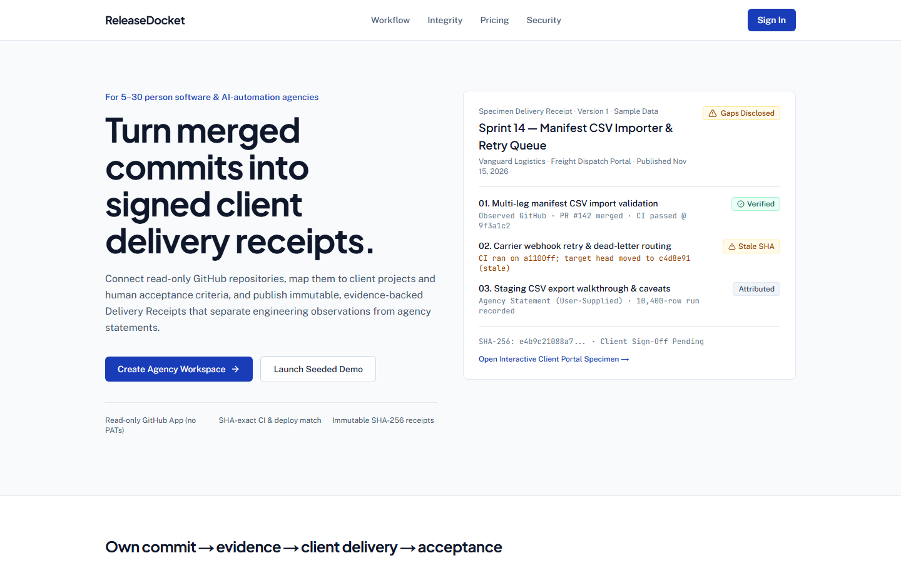
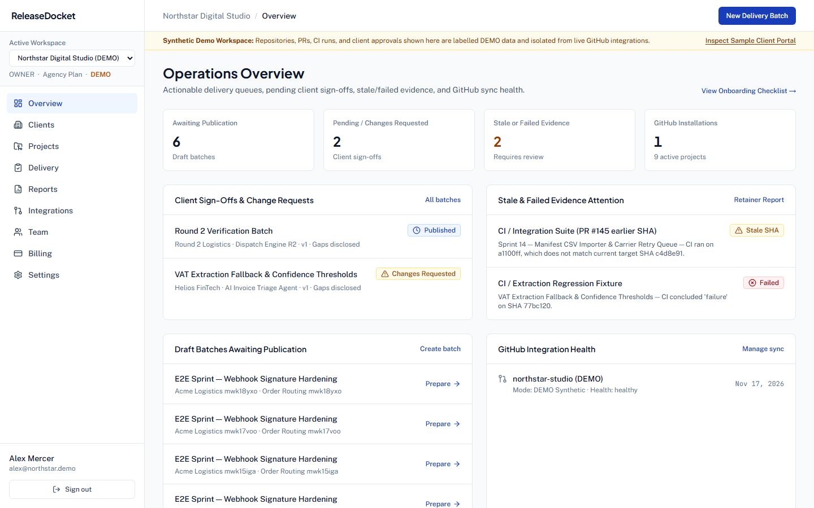
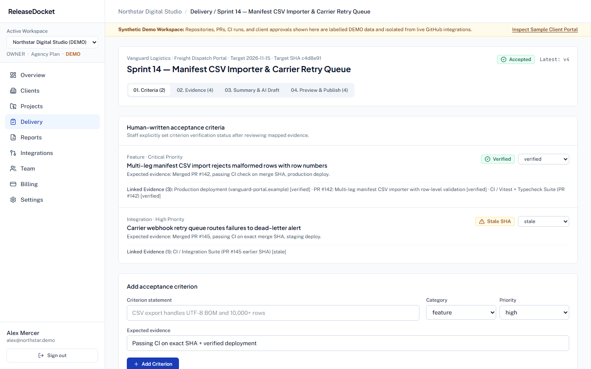
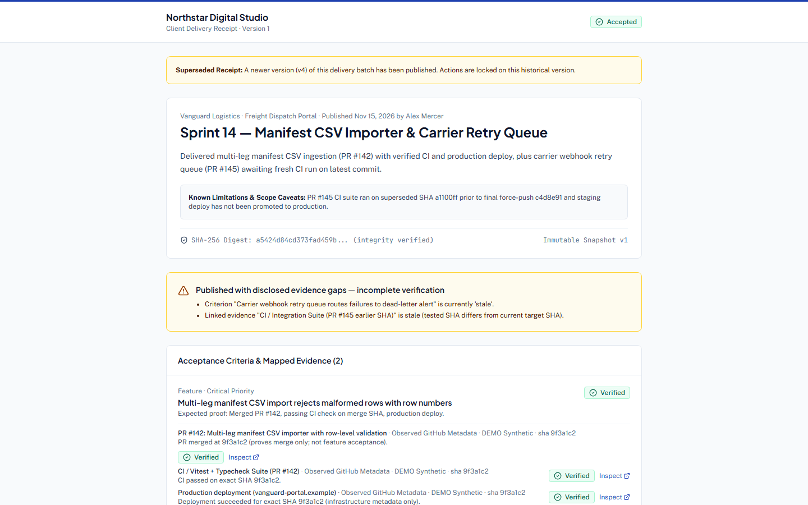

# ReleaseDocket

Turn merged commits into immutable, evidence-backed client delivery receipts. ReleaseDocket is a multi-tenant platform for boutique software and AI-automation agencies (5-30 people) that maps GitHub repositories to client retainers, attaches verifiable engineering evidence to human-written acceptance criteria, and publishes SHA-256 hashed Delivery Receipts with conspicuous gap disclosure and audited client sign-off.

[](https://releasedocket-ggh4.vercel.app)
[](https://github.com/devtechedge/releasedocket_ggh4/actions/workflows/ci.yml)


[](https://opensource.org/licenses/MIT)

## Live Demo

**https://releasedocket-ggh4.vercel.app**

> The production demo runs on Vercel with an in-memory SQLite database seeded with a clearly labelled synthetic agency (Northstar Digital Studio). It resets on cold start. GitHub and Stripe integrations are read-only or demo-mode; no production credentials are used.

Open the live site and press **Launch Seeded Demo** to explore the workspace, or inspect a [sample client portal](https://releasedocket-ggh4.vercel.app/portal/demo-vanguard-v1-token).

## Screenshots






## What it does

- **Multi-tenant agency workspaces** with RBAC roles (OWNER, ADMIN, DELIVERY_LEAD, CONTRIBUTOR, CLIENT_VIEWER) enforced server-side on every query and mutation.
- **Read-only GitHub App integration** that ingests pull requests, reviews, check runs, workflow runs, deployments, and releases. No PATs, no source code storage, constant-time webhook signature verification, idempotent delivery processing.
- **Evidence integrity rules** enforced in domain logic: CI success applies only to the exact tested SHA, deployments verify only on matching SHA, missing status is never green, and merged PRs never auto-complete human acceptance criteria.
- **Immutable Delivery Receipts** published as SHA-256 hashed snapshots (v1, v2, ...) with explicit gap disclosure, superseding on edit and stripping internal agency notes from everything client-visible.
- **Client sign-off portal** at `/portal/[token]` with unguessable hashed tokens, optional 6-digit OTP, noindex headers, and an audited trail of accept / request-changes / comment actions.
- **Retainer snapshot reports** separating GitHub facts from agency statements, with Markdown and print/PDF export.
- **Server-side billing entitlements** (Solo $99, Studio $249, Agency $499, Partner $999) activated only by verified Stripe webhooks, with historical read access preserved after downgrade.

## Tech stack

| Layer | Choice |
| --- | --- |
| Framework | Next.js 15 (App Router), React 19 |
| Language | TypeScript, strict mode |
| Styling | Tailwind CSS 4 |
| Database | PostgreSQL / Neon via Drizzle ORM, embedded SQLite fallback for local and demo runs |
| Validation | Zod |
| Auth | Database-backed sessions, scrypt hashing, HttpOnly Secure cookies |
| Integrations | GitHub App (webhooks), Stripe, Resend email adapter, optional server-side Gemini drafts |
| Jobs | DB-backed outbox queue |
| Tests | node:test unit/integration + Playwright E2E |
| CI | GitHub Actions (lint, typecheck, tests, build, E2E) |

## Quick start

```bash
npm install
npm run dev
```

Open `http://localhost:3000`. Without a `DATABASE_URL`, ReleaseDocket runs on embedded SQLite (`.data/releasedocket.sqlite`) and seeds the isolated Northstar Digital Studio demo workspace when you open the demo.

```bash
npm run lint
npm run typecheck
npm test
npm run build
npx playwright test
```

## Documentation

- [Architecture & data model](docs/ARCHITECTURE.md)
- [Engineering decisions](docs/DECISIONS.md)
- [Build plan](docs/BUILD_PLAN.md)
- [GitHub App setup (read-only)](docs/GITHUB_APP_SETUP.md)
- [Security & multi-tenancy](docs/SECURITY.md)
- [Stripe billing & entitlements](docs/BILLING.md)
- [Operations & deployment](docs/OPERATIONS.md)

## License

MIT
